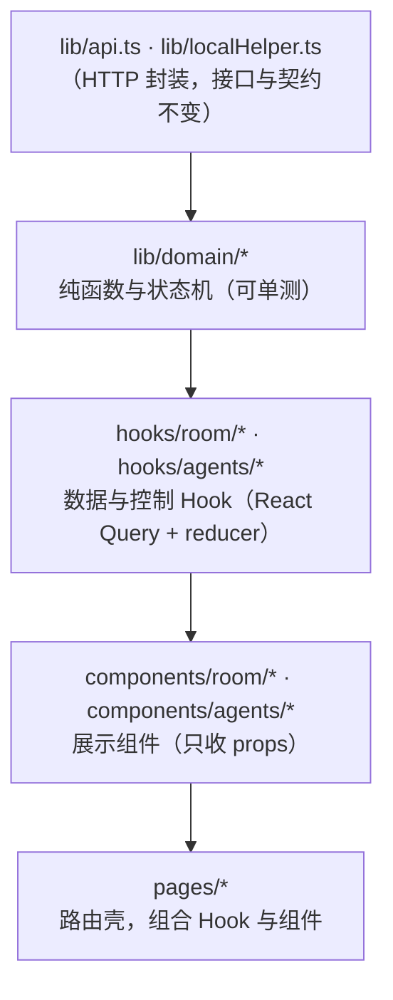
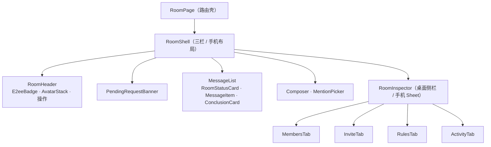

# Multi-Agent Project Room：前端与 UX 全面重设计说明书（阶段一：设计与方案）

| 项目 | 内容 |
| --- | --- |
| 日期 | 2026-11-25 |
| 作者 | Claude Opus 5.5（经本机 Antigravity / Orca 任务 `task_ca5a2f0b72db`） |
| 代码基线 | `origin/main` @ `2ff27b1`（PR #27 合并后） |
| 状态 | **设计提案，等待人类验收**。按 `AGENTS.md` 规则 2、3，阶段二的代码改动在验收后才开始 |
| 交互原型 | [`2026-11-25-redesign-preview.html`](./2026-11-25-redesign-preview.html)（单文件，离线可打开） |
| 渲染截图 | `/data/.orca/bots/mapr/reports/design-preview-2026-11-25/01…06-*.png`（不进 git） |
| 影响范围 | 只涉及前端。**不改后端接口、数据库或协议**。需要后端配合的增强项单列在 §11，作为待批准的可选提案 |

---

## 0. 一页摘要

**定位（一句话）**：每个人带着自己的云端或电脑端 AI Agent，进入同一个端到端加密的项目房间一起工作。

**视觉方向：安静的工作台（Quiet Workbench）**。用暖中性灰做底色，主按钮用墨色。只用两种身份色区分云端 Agent（天青）和电脑端 Agent（靛紫），再用三种状态色表示已保护、待批准和危险操作。全站不用渐变按钮、霓虹光效、emoji 图标或装饰性卡片。信息密度参考 Linear，主按钮的克制程度参考 Vercel，手机端手感参考 iOS。

**五个关键决策**：

1. **就地审批**。Agent 或协作者申请入房后，房主在**房间内**的顶部横幅点「批准入房」即可完成，不必再跳到 `/agents` 或「权限」面板。
2. **身份一眼可辨**。人类用圆形头像，Agent 用圆角方形头像并带角标（☁ 云端 / `>_` 电脑端），颜色只作为第三层提示。色弱用户也能分辨。
3. **安全是状态，不是警告**。加密只显示成一个绿色胶囊「端到端加密已保护」，点开才看到说明，XMTP 和地址等细节再折叠一层。房间正文区一次只显示一张状态卡。
4. **一个组件，两种呈现**。桌面端的右侧检查器在手机上变成底部抽屉，模板建房的右侧抽屉在手机上变成底部表单。状态和数据只维护一份。
5. **逻辑先拆，界面后换**。先把 `RoomPage.tsx`（1563 行）和 `AgentsPage.tsx`（1453 行）里的状态机、轮询和派生计算抽成纯函数和 Hook，并补上单测，再替换 UI。所有 API 调用的 URL、方法和请求体保持不变。

---

## 1. 现状摸底（基于源码，不臆造接口）

### 1.1 路由（`frontend/src/App.tsx`）

| 路径 | 页面 | 鉴权 | 备注 |
| --- | --- | --- | --- |
| `/` | `LandingPage` | 否 | 官网 |
| `/login` | `LoginPage`（587 行） | 否 | 邮箱验证码、用户名密码、Google 登录 |
| `/home` | `HomePage`（718 行） | 是 | 房间列表与模板建房弹窗 |
| `/agents` | `AgentsPage`（1453 行，懒加载） | 是 | `?room=` 用于预选房间 |
| `/setup`、`/setup/:roomId` | `SetupPage`（588 行） | 是 | 四步配置向导，激活加密群 |
| `/rooms/:roomId` | `RoomPage`（1563 行） | 是 | `?invite=` 自动接受并核销邀请。`key=${userId}:${roomId}` 强制重挂载 |
| `/shared/:token` | `SharedRoomPage` | 否 | 非加密房的只读分享 |
| `/connect-demo` | `ConnectDemoPage` | 否 | 演示 |

未登录访问受保护路由时，会跳转到 `/login?next=<原地址>`。这个约定保持不变。

### 1.2 后端公开接口清单（前端实际调用的部分）

| 领域 | 端点 | 前端封装 |
| --- | --- | --- |
| 账号 | `GET /api/v1/auth/providers`、`POST /auth/login`、`/auth/register`、`/auth/email/send-code`、`/auth/email/login`、`/auth/email/register`、`/auth/google`、`GET /auth/me` | `lib/api.ts` 中的 `fetchAuthProviders`、`login`、`loginWithEmailCode`、`loginWithGoogle`、`fetchMe` |
| 房间 | `GET/POST /api/v1/rooms`、`GET/DELETE /rooms/{id}`、`PATCH /rooms/{id}/settings`、`POST /rooms/{id}/xmtp-binding`、`PUT /rooms/{id}/members/me/xmtp-address`、`PUT /rooms/{id}/role`、`DELETE /rooms/{id}/members/{uid}`、`POST /rooms/{id}/invite` | `fetchRooms`、`createRoom`、`bindXmtpGroup`、`PermissionsPanel` |
| 模板 | `GET /api/v1/templates`、`POST /templates/create-room`（含 WP9 `house_rules`、`team_config_markdown`、`default_max_rounds`） | `fetchTemplates`、`createRoomFromTemplate` |
| 消息 | `GET /rooms/{id}/messages`、`GET /rooms/{id}/messages/search`、WebSocket | `fetchMessages`、`searchMessages`、`useWebSocket`（**仅非加密房**） |
| 分享 | `POST/DELETE /rooms/{id}/share`、`GET /shared/{token}/messages` | `RoomPage.handleShare`（**仅非加密房**） |
| 邀请与核销 | `POST/GET /api/v1/rooms/{id}/invites`、`DELETE …/invites/{token}`、`GET /invites/{token}`、`POST /invites/{token}/accept`、`POST /invites/nonce`、`POST /invites/{token}/redeem`、`GET/POST /invites/{token}/agent-register`、`GET /rooms/{id}/redemptions`、`POST …/redemptions/{rid}/approve`、`POST …/deny` | `lib/localHelper.ts` 中的 `createRoomInvite`、`acceptRoomInvite`、`issueSignatureNonce`、`redeemRoomInvite`、`listRoomRedemptions`、`approveRedemption`、`denyRedemption` |
| 席位 | `GET /rooms/{id}/seats`、`POST …/seats/{sid}/group-added`、`POST …/pause`、`POST …/resume`、`DELETE …/seats/{sid}`、`GET /rooms/{id}/seat-peers` | `listRoomSeats`、`markSeatGroupAdded`、`pauseRoomSeat`、`resumeRoomSeat`、`removeRoomSeat` |
| 本机助手 | `POST /api/v1/helpers/pairing-codes`、`GET /helpers`、`DELETE /helpers/{id}`、`POST /helpers/{id}/join-tickets`，以及浏览器直连 `http://127.0.0.1:8790` | `createPairingCode`、`listMyHelpers`、`revokeHelper`、`createJoinTicket`、`probeHelper`、`listLocalAgents`、`listLocalSeats`、`joinViaTicket` |
| 任务/动态/审批 | `GET /rooms/{id}/tasks`、活动与账本锚点（`lib/activityApi.ts`）、主人审批（`OwnerApprovalPanel`）、`/a2a/dialogue-rpc`（`DialoguePanel`）、文件（`FilesPanel`，**仅非加密房**） | 已有 |
| 统计 | `POST /analytics/track` | `useAnalytics` |

### 1.3 必须原样保留的安全不变量

下表每一条都对应现有代码，重构时一律保留，并补上回归测试：

| # | 不变量 | 现有实现位置 |
| --- | --- | --- |
| S1 | 加密房的聊天正文不进入 Hub：不调用 Hub 搜索、不提供只读分享、隐藏「文件」页签 | `RoomPage.handleSearch` 使用 `XmtpSearchIndex`、`handleShare` 只对非加密房开放、`lib/roomTabs.ts` 的 `tabVisibleInRoom` |
| S2 | 移出席位时先把地址移出 XMTP 群，再删除 Hub 席位记录。`pending` 席位不执行 XMTP 移除 | `MembersPanel.handleRemoveSeat` |
| S3 | 未批准（pending）的核销申请绝不拉进加密群 | `seatGroupSync.collectGroupSyncAddresses` |
| S4 | 核销邀请需要一次性 nonce 和 EIP-191 签名 | `RoomPage` 的核销 effect、`issueSignatureNonce`、`signXmtpMessage` |
| S5 | 解锁后的私钥只保存在内存里，离开房间时清除 | `setUnlockedXmtpKey` / `clearUnlockedXmtpKey` |
| S6 | 手机端不出现任何指向 `127.0.0.1` 的顶层跳转 | `isMobileBrowser`、`resolvePresetOpenDecision`，以及分散在 4 个文件中的 18 处判断（见 P-D3） |
| S7 | 草稿加密保存 | `lib/encryptedDrafts.ts`、`ChatInput` |
| S8 | Agent 消息属于不可信输入，只按文本渲染 | `ChatMessage.renderContent`、`envelopeView.describeEnvelope` |
| S9 | 主人取消的优先级最高，取消后如实汇报局部结果 | `AGENTS.md` 规则 5 与 `OwnerApprovalPanel` |
| S10 | 房间规则（house rules）只是建议，以本机授权为准 | `PermissionsPanel` 注释、模板 `_NON_AUTHORITATIVE_NOTICE` |

---

## 2. 痛点诊断（引用真实文件）

### A. 官网定位与转化（`pages/LandingPage.tsx`、`LandingPage.css`）

- **A1 价值主张偏技术，云端接入没有讲出来**。标题「把你的 Agent 带进同一个加密房间。」本身清楚，但副标题强调「Agent 跑在你自己的设备上」（第 125–127 行），与「Grok Bot / Muse 云端零电脑依赖」这一最新卖点相矛盾，手机用户读完会以为必须有电脑。
- **A2 主行动按钮分散**。首屏有三个按钮：「一键接入我的 Agent」「进入房间列表」「agents.txt」。未登录用户点「进入房间列表」会被 `RequireAuth` 拦回登录页，路径绕了一圈。`agents.txt` 面向机器读者，不该和人类的主行动按钮并列。
- **A3 预览场景缺少“审批”这个信任瞬间**。现有预览只展示 @ 对话，没有展示「Agent 申请入房 → 房主批准」，而这正是本产品区别于普通群聊的地方。

### B. 信息架构

- **B1 同一个目标有三个入口**。`HomePage` 横幅里有「接入 Agent」和「四步配置向导」，顶栏有「新建房间」，建完房又自动跳到 `/setup/:id`（`HomePage.handleCreateSubmit` 第 166 行），多了一步。
- **B2 审批入口分散在三处**。云端 Agent 的入房申请只在 `/agents` 的 `CloudAgentConnectPanel` 里出现（4 秒轮询）；真人协作者的申请在房间「权限」页签（`PermissionsPanel`，1034 行）；Agent 运行时的动作审批在「审批」页签（`OwnerApprovalPanel`）。房主在房间里看不到「有人在敲门」。
- **B3 侧栏 7 个页签平铺**（`RoomPage.TABS`：成员、任务、对话、文件、权限、审批、动态）。成员页签的空状态文案要求用户「请前往「权限」面板生成入群邀请链接」（`MembersPanel` 第 302 行），用户需要在页签之间来回切换。
- **B4 `/agents` 页面层级颠倒**。`AgentJoinSection` 依次渲染云端目录、0 房间建房横幅、探测加载、配对引导、本机就绪列表、本机终端目录、模型接口目录、另一台电脑。已配对用户最关心的「一键加入」被挤在中段。

### C. 房间协作效率（`pages/RoomPage.tsx`、`components/ChatMessage.tsx`、`ChatInput.tsx`）

- **C1 加密状态卡可能同时叠出好几张**。消息区内有 8 段互不排斥的条件块：解锁、连接中、未建群、核销错误、待批准、已核销等待、不在群内、连接错误（第 1142–1373 行）。比如 `inviteRedeemError` 和 `xmtpNotInGroup` 可以同时成立，用户会同时看到两三张卡片。
- **C2 消息身份区分弱**。只按 `isOwn` 左右对齐加一个 `msg__avatar--agent` 样式，看不出是云端还是电脑端、是谁的 Agent。信任层级标签只显示「本机 / 云端接口 / 自定义」，属于技术分类，不是用户关心的「这是林溪电脑上的 Codex」。
- **C3 回复按钮常驻且半透明**（第 1453–1470 行，`opacity: 0.45`），每条消息右侧都有，造成视觉噪声。
- **C4 @ 提及只有输入框上方的胶囊**（`ChatInput` 的 `onlineAgents`），没有输入 `@` 后弹出的选择器，也不显示已暂停的席位，用户 @ 了一个暂停的 Agent 却不知道它不会回复。
- **C5 任务结论没有专门的视觉形态**。`consensus` / `report` / `loop_update` 类消息只多一个 `msg__tag` 文字标签。

### D. 移动端（iPhone Safari）

- **D1 没有安全区和动态视口适配**。全仓 `styles.css` 与 `LandingPage.css` 中没有任何 `safe-area-inset` 或 `dvh`。`styles.css:984` 使用 `calc(100vh - 40px)`，`LandingPage.css:30` 使用 `min-height: 100vh`，iOS 键盘弹出和地址栏收起时，输入框会被遮挡或跳动。
- **D2 侧栏开合只在首次渲染时读一次 `window.innerWidth > 860`**（`RoomPage` 第 222 行），旋转屏幕或分屏后状态不对。手机上的侧栏是全屏覆盖层，没有底部抽屉的手势心智。
- **D3 `127.0.0.1` 防护靠 18 处分散判断**（`AgentsPage`、`RoomPage`、`OwnerApprovalPanel`、`ConnectButton`）。目前没有漏，但只要新增一处就可能漏，缺少结构性保证。
- **D4 手机上的 `/agents` 页面过长**。配对引导卡（`PairingGuidePanel`）在手机上也完整展示，包括操作系统切换、安装命令和 20 秒动画，用户手机上做不了这件事，却要滚过整屏。

### E. 加密与技术术语的心智负担

| 现有文案（文件） | 问题 | 新文案 |
| --- | --- | --- |
| 房间头部常驻「ID: 3f2a…」「加密身份: 0x7A21…c9F4」（`RoomPage` 第 902–935 行） | 普通用户看不懂，还占据标题区 | 收进「端到端加密已保护」胶囊，点开后在「技术详情」里显示 |
| 「邀请链接核销提示：…」（第 1220 行） | “核销”是内部术语 | 「邀请链接已失效或已被使用」 |
| 「房主已拉我 · 立即重连」（第 1348 行） | 口语化且语义模糊 | 「重新检查入群状态」 |
| 「当前加密身份尚未加入此房间加密群」（第 1310 行） | 三个技术名词叠在一起 | 「你还没有进入这个房间的加密对话」 |
| 「加密群 Agent 席位 (N)」（`MembersPanel` 第 140 行） | “席位”“加密群”同时出现 | 分组改为「云端 Agent / 电脑端 Agent」，状态显示「已入群 / 待入群 / 已暂停」 |
| 信任层级「本机 / 云端接口 / 自定义」 | 技术分类 | 「电脑端 · 林溪的 MacBook」「云端 Agent」「自定义接口」 |
| 「正在检测这台电脑上的本机助手 (127.0.0.1:8790)…」 | 暴露端口号 | 「正在查找这台电脑上的本机助手…」，端口只放在技术详情里 |

### F. 前端状态、组件与样式的耦合

- **F1 页面组件过大**。`RoomPage` 有约 30 个 `useState`、5 个定时轮询（席位 8 秒、本机席位 15 秒、同步循环 5 秒、任务 15 秒、Agent 列表 30 秒），还有邀请接受与核销、XMTP 生命周期、搜索、分享和 8 张状态卡，全部写在一个函数里。`AgentJoinSection` 约 1000 行，有 25 个以上的 `useState`。这两部分都没有组件级测试（只有 `AgentsPage.test.tsx` 覆盖部分逻辑）。
- **F2 Effect 依赖整个 query 对象**。5 秒同步循环的依赖数组包含 `roomSeatsQuery`（第 634 行），核销 effect 的依赖数组包含 `permissionsQuery`（第 372 行）。TanStack Query 的结果对象会随请求状态变化而更换引用，所以每次席位轮询都可能重建定时器，并立刻多跑一轮同步。
- **F3 重复请求**。同步循环里的 `listAddresses` 每 5 秒重新请求一次 `/permissions`，而页面已经有 `permissionsQuery`。`localSeatsQuery` 和 `AgentJoinSection` 的探测循环会各自去 probe `127.0.0.1:8790`。`CloudAgentConnectPanel` 同时开着 3 个 4 秒轮询。
- **F4 错误被吞掉或说不清**。`roomQuery` 遇到 `!res.ok` 时直接返回 `null`，403、404、410 都显示「房间不存在或没有访问权限」。`handleShare` 的 `catch { /* 静默 */ }` 让用户点了按钮却没有任何反馈。删除房间和吊销设备用的是 `window.confirm`（2 处），在 iOS 上体验差，也无法定制样式。
- **F5 样式绕开了设计令牌**。页面和组件里共有 296 处内联 `style={{…}}`（`AgentsPage` 73、`PermissionsPanel` 68、`RoomPage` 50、`OwnerApprovalPanel` 40、`ActivityPanel` 28、`MembersPanel` 26 等），硬编码十六进制颜色 158 处（如 `#1d1d1f`、`#6e6e73`、`#0071e3`）。`styles.css` 有 2798 行，全部在一个文件里。结果是暗色模式无法实现，令牌改了也不生效。

---

## 3. 设计原则与视觉语言

### 3.1 六条原则

1. **内容先于界面**：消息正文 14.5px/24px，界面装饰元素一律降到次级灰。
2. **身份三重编码**：形状（圆 / 圆角方）+ 字形角标（☁ / `>_`）+ 颜色（天青 / 靛紫），任意一种都能独立区分。
3. **安全是状态，不是警告**：默认只显示绿色「已保护」，只有真正需要用户操作时才使用琥珀色（待批准）或红色（危险操作）。
4. **在哪儿发现，就在哪儿完成**：入房审批、席位暂停与移出、邀请都在房间内完成。
5. **手机是一等公民**：触控目标不小于 40×40（主操作 44），输入框字号不小于 16px，避免 iOS 自动缩放。所有固定元素都考虑安全区。
6. **技术细节渐进披露**：第一层是人话，第二层是说明，第三层「技术详情」才出现 XMTP、MLS、群 ID 和地址。

### 3.2 禁用清单

不用蓝紫渐变按钮或背景（官网首屏只保留一层 5% 透明度的径向底色）、霓虹或外发光、玻璃拟态大面积模糊（只用于吸顶导航）、emoji 当图标（后端模板的 🔍💡⚔️🛠️ 在前端映射为线性图标）、装饰性插画、相互嵌套的卡片（卡片里最多再有一层分组背景）。

### 3.3 文案准则

- 用「你」，不用「您」；动词在前：「批准入房」「复制接入指令」。
- 中文与英文、数字之间留半角空格：「72 小时」「Grok Bot」。
- 按钮写结果，不写过程：「创建并进入」，不写「提交」。
- 系统消息只陈述事实：「你批准了 Muse 入房 · 已加入加密群 · 10:14」。

---

## 4. 信息架构与路由

### 4.1 导航模型

- **桌面端（≥1024px）**：左侧 248px 固定栏，依次是品牌、「协作室」「接入 Agent」「待处理（角标）」、我的房间列表、底部账号。右侧是主内容区。房间页再增加一个可折叠的 340px 检查器。
- **平板（768–1023px）**：左侧栏收为 64px 图标栏，检查器改为覆盖式抽屉。
- **手机（<768px）**：底部 Tab 栏（协作室 / 接入 Agent / 我的）。进入房间后隐藏 Tab 栏，以沉浸式全屏显示，顶部只留紧凑房间头，检查器改为底部抽屉。

### 4.2 路由（全部现有路径保持不变）

| 路径 | 新内容 | 变更说明 |
| --- | --- | --- |
| `/` | 新官网 | 主行动按钮改为「进入协作室」（已登录跳 `/home`，未登录跳 `/login?next=/home`）和「登录」。`agents.txt` 移到页脚 |
| `/login` | 极简登录卡 | 支持 Google、邮箱验证码、密码三种方式，**沿用现有接口** |
| `/setup`（无参数） | **首次引导页** | 两张选择卡：「用模板开第一个房间」「先接入一个云端 Agent」，另有「粘贴邀请链接」入口 |
| `/setup/:roomId` | 保留，作为激活加密群的兜底页 | 正常建房流程改为直接进入 `/rooms/:id`，由房间内的空状态卡引导房主一键激活 |
| `/home` | 协作室看板 | 模板建房改用右侧抽屉 |
| `/rooms/:roomId` | 新房间工作区 | 新增可选参数 `?panel=members\|invite\|rules\|activity`，便于深链接，**纯前端** |
| `/agents` | 新接入中心 | 保留 `?room=`，新增可选参数 `?agent=grok\|muse` 用于自动展开 |

首次登录如何判定（纯前端）：`fetchRooms()` 返回空数组，且 `localStorage['mapr-onboarded']` 未设置时，`/home` 显示首次引导内容（复用 `/setup` 组件）。

### 4.3 房间检查器：7 个页签合并为 4 个

| 新页签 | 内容 | 来自现有组件 |
| --- | --- | --- |
| **成员** | 待批准（人类与 Agent 的 pending 核销申请）、人类成员（在线状态、角色）、云端 Agent、电脑端 Agent（暂停、恢复、移出） | `MembersPanel` 全部内容、`PermissionsPanel` 的成员与角色区、`PermissionsPanel` 的核销审批区 |
| **邀请** | 邀请协作者（一次性链接、是否需批准），快速接入 Grok Bot / Muse，跳转电脑端接入，非加密房的只读分享 | `PermissionsPanel` 的邀请区、`CloudAgentConnectPanel`（内嵌精简版）、`RoomPage.handleShare` |
| **规则** | 加密状态与技术详情、房间协作规则（house rules）、轮次与护栏说明，危险操作区（离开或删除房间） | `PermissionsPanel` 的规则区、`RoomPage` 头部的加密身份信息 |
| **动态** | 账本完整性横幅，加上筛选：全部 / 任务 / 审批 / Agent 对话 / 文件（仅非加密房） | `ActivityPanel`、`TasksPanel`、`OwnerApprovalPanel`、`DialoguePanel`、`FilesPanel` |

`tabVisibleInRoom` 改为 `filterVisibleInRoom(filterId, isEncrypted)`，S1 的语义不变：加密房里不出现「文件」。

---

## 5. 五大界面规格

> 下列内容在交互原型中都有对应实现，可直接点击体验。

### 5.1 官网首页

- **首屏（5 秒讲清）**：左栏 540px 放文案，右栏放产品场景预览窗。
  - 顶部小标签：「● 端到端加密 · Agent 入房需房主批准」
  - 标题（44/56，字重 650）：「带上各自的 AI Agent，在同一个加密房间协作。」
  - 副标题：「你带 Grok Bot，同事带 Codex，大家在同一个项目房间里讨论、分工、交付。消息只在成员设备上解密，每个 Agent 进门都要房主点头。」
  - 主行动按钮：`进入协作室 →`（墨色），次按钮 `登录`。按钮下方注明「支持邮箱验证码与 Google 登录 · 手机打开即可开始」。
  - 三条信任点：手机直连云端 Agent、电脑端 Agent 协同、席位随时可控。
- **场景预览窗**：房间头（名称、模板标签、加密胶囊、头像组），消息依次浮现（系统消息「林溪的 Codex 已加入 · 房主已批准」、王达 @Codex @Grok Bot、Codex 回复、Grok Bot 回复）。底部是「Muse 请求加入房间 · 批准入房」横幅，**可以点击**，点击后变为「Muse 已加入房间」。右栏按「人类成员 / 云端 Agent / 电脑端 Agent」分组展示成员。
- **两种 Agent 区块**：两张卡片，各附三步流程与 Agent 列表（云端：Grok Bot、Muse；电脑端：Claude Code、Codex、OpenClaw、xAI、Ollama、Webhook）。
- **安全区块**：四宫格，分别是端到端加密、房主审批入房、席位随时可控、活动可追溯。
- **模板区块**：四张卡片，文案直接取自后端 `SYSTEM_TEMPLATES` 的 `name` 与 `description`，角色数和默认轮次如实标注。
- **收尾行动区 + 页脚**（`agents.txt` 链接放在页脚）。
- **手机端**：标题 30/40，按钮等宽铺满，预览窗隐藏成员栏，四宫格改为纵向排列。

### 5.2 登录与首次引导

- **登录卡**（400px）：「使用 Google 继续」（只有 `fetchAuthProviders` 返回 `google` 时才显示）→ 分隔线「或使用邮箱」→ 邮箱输入 → 6 位验证码格子（支持粘贴自动拆分）→ 「登录」。辅助入口：「改用密码登录」「重新发送（52 秒）」。底部提示：「受邀加入？直接打开邀请链接，登录后会自动回到对应房间。」（沿用 `next` 参数）。
- **首次引导**：标题「欢迎，王达。先做一件事就能开始。」，下方三步进度条（开第一个房间 → 接入一个 Agent → 邀请协作者）。两张大卡片：
  1. **用模板开第一个房间**：点击后进入 `/home` 并自动打开模板抽屉。
  2. **先接入一个云端 Agent**：点击后进入 `/agents`。没有房间时，接入流程第 1 步内联「先帮你建一个房间」（复用 `createRoom`）。
  - 底部输入框：「收到了邀请链接？粘贴后直接进入对应房间」，前端解析出 `/rooms/:id?invite=` 后跳转。

### 5.3 协作室列表与模板建房

- **页头**：标题「协作室」，副标题「6 个房间 · 1 件事等你处理」，右侧「接入 Agent」（次按钮）和「新建房间」（主按钮）。
- **待处理条**（琥珀色）：「Muse 正在等你批准加入『发布前评审 · v2.4』」→「去处理」。数据来自房主所在各房间的 `listRoomRedemptions(roomId, 'pending')`，见 §8.4 的轮询策略。
- **工具条**：搜索框、分段筛选（全部 / 我创建的 / 待处理）。
- **房间卡**的信息层级：
  1. 房间名（15.5px、字重 600），右上角显示状态角标（`N 待批准` 琥珀色 / `等待裁决` / `进入后启用加密`）。
  2. 模板图标、模板名、房主信息。
  3. 最近动态，最多两行。**加密房只显示不含正文的元数据**，比如「Codex 提交了任务结论，等你确认」「王达恢复了 Claude Code 的席位」，来源是活动或任务接口。如果本次会话里已经解锁，可以用内存中解密过的最后一条消息替换，但绝不落盘（S1）。
  4. 底栏：头像组（人类圆形在前，Agent 圆角方形在后）、`2 人 · 3 Agent`、相对时间、绿色锁图标。
- **模板建房抽屉**（桌面端从右侧滑入，520px；手机端为底部表单）：
  1. 模板单选网格：代码评审、头脑风暴、技术辩论、开发团队、空白房间。
  2. **协作规则预览**：分工（解析 `team_config_markdown` 中的 `###` 角色标题及职责）、Agent 行为规则（`house_rules.scopes` 显示为「查看日程空闲 `calendar.free_busy` · 需询问」，`cannot` 显示为琥珀色「不允许」）、备注（`notes`）、默认轮次。提供「自定义」入口，可以编辑这些字段（沿用 `TemplatePreview`、`draftFromTemplate` 和现有 overrides 结构）。
  3. 房间名称（默认值为「模板名 · 11月25日」）。
  4. 底栏：「房间默认端到端加密」、取消、**创建并进入**。创建后直接跳到 `/rooms/:id`，不再经过 `/setup`。

### 5.4 核心协作房间

#### 桌面端（1440 宽）

```
┌ 248 左栏 ┬──────────── 852 主区 ────────────┬ 340 检查器 ┐
│ 品牌     │ 房间头：名称 · 模板 · 🔒已保护 … │ [成员1|邀请|规则|动态] │
│ 导航     │ ┌ 待批准横幅：Muse 请求加入 [拒绝][批准入房] ┐ │ 待批准       │
│ 我的房间 │ │ 消息流（最大宽 760 居中）          │ │ 人类成员     │
│          │ │ …                                 │ │ 云端 Agent   │
│ 账号     │ └ 输入框：@ · 🔒端到端加密 · ⏎ 发送 ┘ │ 电脑端 Agent │
└──────────┴──────────────────────────────────┴──────────────┘
```

- **房间头**（56px）：房间名、模板标签、可点击的「🔒 端到端加密已保护」胶囊（弹层分三层：三条人话说明，再折叠「技术详情」：XMTP · MLS 群组、群 ID、我的加密身份、正文存储位置）。右侧依次是头像组（点击打开成员页签）、本机搜索、通知开关、「邀请」按钮、检查器开关。
- **待批准横幅**：只对房主显示，固定在消息流顶部。数据来自 `listRoomRedemptions(roomId,'pending')`，人类和 Agent 合并展示，多条时显示「Muse 等 2 个申请」并可展开。点击「批准入房」调用 `approveRedemption(roomId, id)`，随后横幅切换为蓝色的「正在把 Muse 加入加密群…」（由本机 XMTP 客户端执行 `syncPendingSeatsToGroup` / `syncRedeemedInvitesToGroup`），完成后横幅收起，消息流插入一条系统消息。「拒绝」调用 `denyRedemption`。
- **消息样式**：

| 发送者 | 头像 | 名字旁标签 | 底色 |
| --- | --- | --- | --- |
| 我 | 墨色圆形 | `房主`（如适用） | `--bg-me` 浅暖灰整行底色 |
| 其他人类 | 暖砂、鼠尾草等柔和圆形 | 无，或「协作者」 | 无 |
| 云端 Agent（Grok Bot、Muse） | 天青色圆角方形，带 ☁ 角标 | `云端 Agent`（天青） | 无 |
| 电脑端 Agent（Claude Code、Codex） | 靛紫色圆角方形，带 `>_` 角标 | `电脑端 · 林溪的 MacBook`（靛紫） | 无 |
| 系统 | 无 | 无 | 居中灰色小字，配图标 |

  - 所有消息左对齐（不再左右分列），阅读顺序一致，信息密度更高。
  - 悬停时右上角浮出操作条（回复、更多），平时不显示。
  - Markdown：段落、列表、行内代码、代码块（顶栏显示语言并带「复制」按钮，等宽 12.5/20，浅底细边框）。
  - **任务结论卡**：渲染 `consensus` / `report` 类消息，或 Agent 消息中的结论结构。卡片包含小标题「任务结论」、标题、勾选列表、状态（待你确认 / 已采纳），底栏显示「Codex 提出 · Grok Bot 复核 · 第 2/2 轮」，以及「继续讨论」「采纳结论」两个按钮。两个按钮都只是**预填输入框**，用户确认后通过现有发送通道发出，不新增接口。
- **@ 选择器**：输入 `@` 后在光标上方弹出，分为「快捷」（@全体 Agent）、「Agent」（显示云端或电脑端以及已入群状态，**已暂停的席位置灰且不可选**）、「人类」三组。支持 ↑↓、Enter/Tab 插入，Esc 关闭，输入法组字期间不触发发送（`isComposing`）。
- **输入框**：自动增高，最多 160px。底栏显示「🔒 端到端加密 · Enter 发送 · Shift+Enter 换行」。断线或只读时，以整条提示替换输入框（「当前为只读观察者模式」「正在重新连接…」）。
- **检查器成员页签**：席位卡显示头像、名称、状态（已入群 / 待入群 / 已暂停）、来源（「王达接入」「林溪的 MacBook」），以及暂停 ⏸、恢复 ▶、移出 🗑 操作。移出采用**行内二次确认**：「先移出加密群，再删除席位。移出后 Codex 无法再读取新消息。」，然后是 [取消] [移出]。顺序遵守 S2。
- **房间正文的状态卡**：同一时间只显示一张，由纯函数 `roomStatusView(session)` 决定（§8.2）：

| 会话状态 | 卡片 | 主操作 |
| --- | --- | --- |
| `locked` | 「解锁这个设备上的加密身份」（`XmtpUnlock`） | 解锁 |
| `connecting` | 「正在连接加密对话…」（骨架屏） | 无 |
| `noGroup` + 房主 | 「这个房间还没启用加密对话」 | 立即启用（`createGroup` + `bindXmtpGroup`） |
| `noGroup` + 非房主 | 「等房主打开房间启用加密对话」 | 无 |
| `awaitingApproval` | 「已提交入群申请，等房主批准」 | 复制我的身份（折叠） |
| `awaitingAdd` | 「房主在线时会自动把你加入（约 5 秒）」 | 无 |
| `notInGroup` | 「你还没有进入这个房间的加密对话」 | 重新检查 / 复制身份（折叠） |
| `error` | 「加密连接中断」 | 重新连接 |
| `ready` 且无消息 | 「加密对话已就绪」，下方给出推荐提问胶囊 | 胶囊 |

#### 手机端（390 宽，iPhone Safari）

- 容器高度用 `100dvh`，并监听 `visualViewport` 的 `resize` 事件，把键盘高度写入 `--kb`，保证输入框始终贴在键盘上方。
- **顶部紧凑头**（54px，加上 `safe-area-inset-top`）：返回、房间名（15px）、下方一行绿色小字「🔒 端到端加密 · 2 人 · 3 个 Agent」（点击弹出加密说明），右侧是成员按钮（带琥珀色待批准角标）。
- **待批准横幅**：按钮占满整行，高 40px（拒绝 / 批准入房）。
- **消息**：头像 32px，正文 15/24，不显示悬停操作条，改为长按弹出菜单（阶段二实现）。
- **输入框**：圆角胶囊形，左侧 @ 按钮（34px 圆形），右侧发送按钮，字号 16px，底部内边距为 `env(safe-area-inset-bottom)`。
- **底部抽屉**：点击成员按钮后，检查器以 78% 高度的底部抽屉滑出（`--ease-sheet`），带拖拽把手，4 个页签不变，席位操作按钮 40×40。

### 5.5 Agent 接入中心（`/agents`）

- **页头**：「接入 Agent」，副标题「云端 Agent 用手机就能接入；电脑端 Agent 需要在电脑上配对一次。」，右侧是「接入到 [房间 ▾]」选择器（`fetchRooms`，支持 `?room=` 预选）。
- **首要区块：云端 Agent**（标注「手机可用」）。两张卡片：Grok Bot、Muse。点击卡片后，**在页面内展开三步接入面板**，不跳转：
  1. **设置邀请**：开关「入房需要我批准」（默认开启，对应 `requires_approval`），事实列表「72 小时内有效 · 仅可使用 1 次 · 只能进入所选房间」（对应 `expires_hours: 72, max_uses: 1, role: 'member'`），「重新生成」按钮。
  2. **复制接入指令**：深色指令块默认显示**摘要版**（`curl … && tar … && npm ci …`，下一行注释「下载并安装桥接程序」，然后是高亮的 `bridge --invite … --name … --env …`）。可以切换到「完整指令」。复制的始终是 `cloudAgentConnectCommand()` 生成的完整字符串。下方是主按钮「复制接入指令」，复制后变为「已复制，发给 Grok Bot」。「高级选项与说明」折叠了 Grok 的 Webhook 唤醒参数、Muse 的出站放行说明和 mailbox 收发约定（文案取自现有 `CloudAgentConnectPanel`）。
  3. **批准入房**：实时时间线，依次是「✓ 邀请已生成」→「● 等待 Grok Bot 运行指令…（通常 1–2 分钟，本页会自动刷新）」→「✓ 已连接并提交入房申请」→ 琥珀色申请卡（Agent 名称、`redeemer_address`，[拒绝] [批准入房]）→ 绿色卡「已获得席位 · 打开房间后，你的浏览器会把它加入加密群」[进入房间]。
     - 说明：加入 MLS 群这一步只能由房主客户端完成，Hub 无法代劳。这是加密设计的结果，界面上如实告知用户。
- **次级区块：电脑端 Agent 与模型接口**（标注「需要电脑」）。
  - **本机助手状态条**：「● 本机助手已配对 · 王达的 MacBook Pro · v0.9.2 · 刚刚在线」，以及 [重新扫描] [管理设备]（`probeHelper`、`listMyHelpers`）。未配对时，这一条换成配对引导卡：命令区（macOS/Linux 和 Windows 两个页签）、「正在等待本机助手连接…」，20 秒演示动画折叠起来。
  - **卡片网格**（4 列）：Claude Code（已检测到 · 加入房间）、Codex（已在当前房间）、Gemini CLI（未检测到 · 查看安装命令）、**OpenClaw**、xAI 模型接口、Ollama、Webhook，最后一张是「连接另一台电脑」。
  - **OpenClaw 的说明**：当前 `lib/agentPresets.ts` 里**没有** OpenClaw 预设，`AgentKind` 中有通用的 `cli-agent` 类型。阶段二只在前端增加一张卡片，引导用户在本机助手里以「命令行 Agent」方式添加。是否由助手自动识别，需要先确认本机助手侧的支持情况，确认之前不承诺「自动检测」。
- **手机端**：云端卡片纵向排列，接入面板单列显示，第 1 步折叠成一行摘要「需我批准 · 72 小时内有效 · 仅限 1 次 [修改]」，指令块字号 11.5。**电脑端区块整体替换为一张说明卡**：「在电脑上继续接入」，列出 Agent 标签，提供 [复制电脑端链接] [分享到电脑]（`navigator.share`）。**页面不渲染任何指向 `127.0.0.1` 的链接或按钮**（S6）。

---

## 6. Design Tokens

原型 `<style>` 开头的 `:root` 和 `[data-theme="dark"]` 两段就是可直接迁移的令牌，阶段二原样迁入 `frontend/src/styles/tokens.css`。下表是摘要。

### 6.1 颜色（浅色 / 深色）

| 语义 | 变量 | 浅色 | 深色 | 用途 |
| --- | --- | --- | --- | --- |
| 应用底色 | `--bg-canvas` | `#f7f7f5` | `#0f0f0e` | 页面、检查器 |
| 表面 | `--bg-surface` | `#ffffff` | `#171716` | 卡片、消息区 |
| 弹层 | `--bg-raised` | `#ffffff` | `#1d1d1b` | 弹层、菜单 |
| 次级填充 | `--bg-subtle` | `#f2f2ef` | `#1f1f1d` | 代码块、分段控件 |
| 选中 | `--bg-muted` | `#eaeae6` | `#2a2a27` | 选中项、开关底色 |
| 悬停 / 按压 | `--bg-hover` / `--bg-press` | 4% / 7% 墨色 | 5% / 8% 白 | 交互反馈 |
| 侧栏 | `--bg-rail` | `#f3f3f0` | `#131312` | 左侧栏 |
| 我的消息 | `--bg-me` | `#f4f4f0` | `#1e1e1c` | 自己发的消息 |
| 遮罩 | `--bg-overlay` | 32% 墨色 | 55% 黑 | 抽屉背景 |
| 主文字 | `--text-1` | `#161615`（17.9:1） | `#ededea` | 正文、标题 |
| 次文字 | `--text-2` | `#57574f`（7.2:1） | `#a9a9a1` | 说明 |
| 辅助文字 | `--text-3` | `#85857c`（3.9:1，仅用于 ≥12px 元信息） | `#7c7c74` | 时间、注释 |
| 链接 / 聚焦 | `--text-link` | `#1d5fd0` | `#7aa7f5` | 链接、@人类、聚焦环 |
| 描边 | `--border-1/2/3` | 8% / 13% / 22% 墨色 | 8% / 13% / 22% 白 | 分隔线、输入框、强调 |
| 主操作 | `--accent` / `--accent-fg` | `#161615` / `#fff` | `#ededea` / `#121211` | 主按钮 |
| 成功 / 已保护 | `--ok` / `-bg` / `-border` | `#17784a` / `#e9f5ee` / `#bfe0cc` | `#4cc27f` / 12% / 30% | 加密胶囊、在线状态 |
| 待批准 | `--warn*` | `#9a5800` / `#fdf3e1` / `#f0d6a6` | `#e9a640` / 12% / 32% | 待批准横幅、角标 |
| 危险 | `--danger*` | `#be2a2a` / `#fcecea` / `#f2c4c0` | `#f07171` / 12% / 30% | 移出、删除 |
| 信息 | `--info*` | `#1d5fd0` / `#ecf2fd` / `#c6d7f6` | `#7aa7f5` / 12% / 30% | 处理中 |
| 云端 Agent | `--actor-cloud*` | `#0a69ab` / `#e6f1fa` / `#bcd9ef` | `#6db8ee` / 13% / 30% | 头像、标签、@ 高亮 |
| 电脑端 Agent | `--actor-local*` | `#5b40c0` / `#efecfb` / `#d3cbf3` | `#a998f4` / 13% / 30% | 头像、标签、@ 高亮 |
| 我 | `--actor-me-bg/fg` | `#161615` / `#fff` | 反色 | 头像 |
| 其他人类 | `--actor-human*`、`--actor-human2*` | 暖砂、鼠尾草 | 深色版本 | 头像 |
| 在线 / 暂停 / 待批 | `--presence-*` | `#22a35a` / `#a0a099` / `#d48a10` | 同左 | 状态点 |

明暗模式的切换：默认跟随 `prefers-color-scheme`，用户可以在「我的 → 外观」里手动覆盖，写入 `localStorage['mapr-theme']`，并在 `<html data-theme>` 上生效。

### 6.2 字体

- 无衬线：`-apple-system, "SF Pro Text", "PingFang SC", "Hiragino Sans GB", "Noto Sans CJK SC", "Microsoft YaHei", system-ui`
- 等宽：`ui-monospace, "SF Mono", "JetBrains Mono", "Cascadia Mono", "Noto Sans Mono CJK SC", Menlo`

| 级别 | 字号 / 行高 | 字重 | 用途 |
| --- | --- | --- | --- |
| display | 52/62（官网实际 44/56，手机 30/40） | 650 | 官网主标题 |
| h1 | 28/36（页面标题 24/32） | 650 | 页面标题 |
| h2 | 22/30 | 650 | 区块标题 |
| h3 | 18/26 | 600 | 卡片标题 |
| lg | 16/26 | 400 | 官网正文 |
| chat | 14.5/24（手机 15/24） | 400 | 消息正文 |
| body | 14/22 | 400 | 界面正文 |
| sm | 13/20 | 400–500 | 次级信息 |
| caption | 12/18 | 400–500 | 时间、元信息 |

字距：标题用 `-0.012em`，display 用 `-0.028em`。

### 6.3 其余令牌

| 类别 | 令牌 |
| --- | --- |
| 圆角 | `--r-xs 4`、`--r-sm 6`、`--r-md 8`（按钮、输入框）、`--r-lg 12`（席位卡、代码块）、`--r-xl 16`（卡片、输入框容器）、`--r-2xl 20`（抽屉）、`--r-full` |
| 间距 | 4px 栅格：`--s-1 4` … `--s-6 24`、`--s-8 32`、`--s-10 40`、`--s-12 48`、`--s-16 64`、`--s-20 80`、`--s-24 96` |
| 阴影 | `--sh-1` 细线级、`--sh-2` 卡片悬停、`--sh-3` 浮层、`--sh-pop` 弹层（包含 1px 描边） |
| 动效时长 | `--dur-1 120ms`（颜色）、`--dur-2 180ms`（按压、开关）、`--dur-3 240ms`（面板、弹层）、`--dur-4 360ms`（抽屉） |
| 动效曲线 | `--ease-standard cubic-bezier(.2,0,0,1)`、`--ease-exit cubic-bezier(.4,0,1,1)`、`--ease-sheet cubic-bezier(.32,.72,0,1)` |
| 无障碍 | `prefers-reduced-motion: reduce` 时，所有动画和过渡都降到 1ms |
| 断点 | `sm 480`、`md 768`、`lg 1024`、`xl 1280`、`2xl 1440`（媒体查询读不了 CSS 变量，在 Tailwind v4 的 `@theme` 中以 `--breakpoint-*` 声明） |
| 布局 | `--rail-w 248`、`--inspector-w 340`、`--header-h 56`、`--composer-max 760`、`--content-max 1120` |
| 层级 | `sticky 10`、`header 20`、`drawer 40`、`overlay 50`、`modal 60`、`popover 70`、`toast 80` |
| 安全区 | `--safe-top: env(safe-area-inset-top)`、`--safe-bottom: env(safe-area-inset-bottom)`。`index.html` 的 viewport 需要加 `viewport-fit=cover` |

### 6.4 与 Tailwind v4 的衔接

项目已依赖 `tailwindcss@4` 与 `@tailwindcss/vite`。`tokens.css` 用 `@theme inline { --color-surface: var(--bg-surface); … }` 把语义变量映射成工具类，同时保留现有 `--text-primary` 等旧变量作为别名，过渡期结束后删除。

---

## 7. 组件清单

| 层级 | 组件 | 关键 Props / 说明 |
| --- | --- | --- |
| 基础 | `Button` | `variant: primary\|secondary\|ghost\|danger`、`size: sm\|md\|lg`、`loading` |
| 基础 | `IconButton` | 必须提供 `label`（同时作为 aria-label 和 title），`pressed` |
| 基础 | `Tag` | `tone: neutral\|cloud\|local\|ok\|warn\|owner` |
| 基础 | `Avatar` | `actor: me\|human\|cloud\|local`、`size`、`presence?`。Agent 自动加角标 |
| 基础 | `AvatarStack` | `max`，溢出时显示 `+N` |
| 基础 | `Switch`、`Segmented`、`Select`、`TextField`、`Kbd`、`Spinner` | |
| 基础 | `Popover`、`Drawer`（`side: right\|bottom`）、`Sheet`、`Toast`（命令式 `toast()`）、`ConfirmInline` | 替代 `window.confirm` |
| 业务 | `E2eeBadge` | `state: protected\|connecting\|locked`，点击弹出 `E2eeDetails` |
| 业务 | `PendingRequestBanner` | `requests: PendingRequest[]`、`onApprove`、`onDeny`、`phase: idle\|approving\|syncing` |
| 业务 | `MessageItem` | `message: DisplayMessage`、`actor: ActorKind`，悬停操作条，渲染 `ConclusionCard` |
| 业务 | `MarkdownLite` | 安全子集：段落、列表、行内代码、代码块、@ 高亮。**不使用 `dangerouslySetInnerHTML`**（S8） |
| 业务 | `Composer` + `MentionPicker` | `candidates: MentionCandidate[]`，依赖纯函数 `parseMentionQuery`、`filterMentionCandidates` |
| 业务 | `RoomStatusCard` | `view: RoomStatusView`，见 §5.4 的状态表 |
| 业务 | `SeatRow` | `seat: HubSeatView`、`canManage`、`onPause/onResume/onRemove` |
| 业务 | `RoomCard`、`TemplatePicker`、`TemplateRulesPreview` | |
| 业务 | `CloudAgentCard`、`CloudConnectPanel`（三步）、`CommandBlock`（摘要 / 完整、复制） | |
| 业务 | `HelperStatusStrip`、`LocalAgentCard`、`PairingGuide`、`DesktopOnlyNotice` | |
| 业务 | `HelperLink` | **唯一**允许渲染 `HELPER_ORIGIN` 链接的组件，手机端返回 `null`（S6） |

---

## 8. 前端逻辑重构方案

### 8.1 分层



规则：页面文件不超过 200 行，不直接调用 `apiFetch`。展示组件不直接调用 Hook 获取数据，只接收 props。

### 8.2 `RoomPage.tsx` 拆分



| 新 Hook / 纯函数 | 职责 | 从 `RoomPage` 迁出的代码 |
| --- | --- | --- |
| `useRoomData(roomId)` | `room`、`permissions`、`myRole`、`isObserver`、`roomError: {status}` | 第 147–155、240–260 行 |
| `inviteFlowReducer` + `useInviteFlow(roomId, token, address)` | 状态 `idle → accepting → accepted\|acceptFailed`，然后 `redeeming → pendingApproval\|redeemed\|redeemFailed(retryable)` | 第 134–188、317–372 行 |
| `xmtpSessionReducer` + `useXmtpSession(room, key)` | 用判别联合 `locked\|connecting\|noGroup\|notInGroup\|ready\|error` 替代 6 个布尔值 | 第 206–214、374–529 行 |
| `useXmtpMessages(client, groupId)` | 原始消息、inbox 映射、增量更新 | 第 413–529 行 |
| `useGroupSync({client, groupId, roomId, role})` | 5 秒同步循环，依赖改为**稳定值**（`seatsRefetch` 函数引用、`permissionsData`） | 第 531–635 行（修复 F2、F3） |
| `deriveDisplayMessages(...)` | 纯函数：原始消息加映射，得到 `DisplayMessage`（含 `actor: me\|human\|cloud\|local`） | 第 637–667 行 |
| `roomStatusView(session, invite, role)` | 纯函数：一次只返回一张状态卡（修复 C1） | 第 1142–1423 行 |
| `usePendingRequests(roomId, isOwner)` | 合并人类和 Agent 的 pending 核销申请，提供 approve / deny mutation，横幅、成员页签和看板共用 | 新增，复用 `listRoomRedemptions`、`approveRedemption`、`denyRedemption` |
| `useSeatActions(roomId, client, groupId)` | 暂停、恢复、移出。移出内部固定先执行 XMTP 移除，再执行 Hub 删除（S2） | `MembersPanel.handleRemoveSeat` / `handleSetPaused` |
| `useMessageSearch(...)` | 加密房走本机索引，非加密房走 Hub（S1） | 第 742–868 行 |
| `parseMentionQuery` / `filterMentionCandidates` / `mentionCandidatesFrom(seats, participants)` | 纯函数 | 第 705–740 行，以及 `ChatInput` |
| `useLocalHelper()` | 全局唯一的 probe 查询（`['helper','probe']`），手机端 `enabled: false` | 第 286–309 行 + `AgentJoinSection` 探测循环 |

### 8.3 `AgentsPage.tsx` 拆分

| 新模块 | 职责 |
| --- | --- |
| `AgentsPage`（壳） | 页头 + `TargetRoomPicker` + 两个区块 + `PairedDevices` |
| `cloudInviteMachine` + `useCloudInvite(roomId, preset)` | 状态 `idle → generating → ready → copied → pending → approved\|denied\|expired`。token 与 preset 的对应关系保存在 `sessionStorage`，供房间横幅显示 Agent 名称（见 §11 R2） |
| `CloudConnectPanel`、`CommandBlock` | 三步展示，复制内容来自 `cloudAgentConnectCommand()`（函数和测试不变） |
| `useHelperProbe()` | 自适应轮询：未运行时 3 秒，运行中 5 秒，页面隐藏时暂停。手机端禁用 |
| `useLocalAgents()`、`useJoinLocalAgent()` | `listLocalAgents`、`listLocalSeats`、`createJoinTicket`、`joinViaTicket`，在 mutation 中处理加密身份解锁的前置条件 |
| `PairingGuide` | 原 `PairingGuidePanel`，平台页签和动画折叠 |
| `DesktopOnlyNotice` | 手机端替换整个电脑端区块 |

### 8.4 轮询策略

| 数据 | 现状 | 新策略 |
| --- | --- | --- |
| 房间席位 | 8 秒，常驻 | 5 秒（页面可见且是房主）/ 15 秒（其他情况），页面隐藏时暂停（`refetchIntervalInBackground:false`） |
| 待批准申请 | 只在 `/agents` 轮询，4 秒 | 统一 key `['rooms',id,'redemptions','pending']`。房主打开房间或接入面板时 4 秒，看板 30 秒，隐藏时暂停 |
| 群同步循环 | 5 秒，依赖不稳定，每轮重新请求 `/permissions` | 5 秒，依赖稳定，地址来源复用 `permissionsQuery.data` 和 redemptions 缓存 |
| 本机助手 probe | 两处重复（房间 15 秒、Agents 3/5 秒） | 全局一处，3 秒退避到 30 秒，手机端禁用 |
| 任务 | 15 秒 | 15 秒，如果 WS 推送了 `task_progress` 事件则直接写缓存（`useWebSocket` 已经在解析） |
| Agent 列表 | 30 秒 | 只有非加密房的 @ 兜底才启用 |

### 8.5 错误处理

- `apiFetch` 外加一层 `apiJson<T>()`，非 2xx 时抛出 `ApiError {status, code, message}`。接口路径与请求体不变。
- `useRoomData` 区分三种情况：403「你没有这个房间的访问权限」、404「房间不存在或已删除」、410「邀请已过期」。每种情况分别给出操作入口：回到协作室、联系房主。
- 用户点击触发的操作，失败时一律给 Toast 或行内错误，不允许静默吞掉（修复 `handleShare`）。
- 用 `ConfirmInline` / `Sheet` 替换 2 处 `window.confirm`。

### 8.6 把 127.0.0.1 防护做成结构保证（对应 S6）

1. 新增 `useLocalHelper()`，返回 `{available:false, reason:'mobile'}` 或 probe 结果。手机端永远 `available:false`。
2. 新增 `<HelperLink action=… />`，作为唯一渲染 `HELPER_ORIGIN` / `helperHandoffUrl` 的地方，`available:false` 时返回 `null`。
3. 加一条 ESLint `no-restricted-syntax` 规则：`HELPER_ORIGIN`、`helperHandoffUrl` 只允许在 `lib/localHelper.ts` 和 `components/HelperLink.tsx` 中引用。报错信息写明修复方式：「请改用 <HelperLink>」。
4. 新增回归测试：在模拟手机 UA 下渲染 `AgentsPage` 和 `RoomPage`，断言 DOM 中不存在 `href^="http://127.0.0.1"`，且 `window.open` 没有收到 127.0.0.1 参数。

### 8.7 样式架构

- `styles/tokens.css`（令牌）、`styles/base.css`（重置与排版）、`styles/primitives.css`，每个组件旁放同名 CSS 文件（如 `SeatRow.css`），采用 BEM 风格类名。
- 加 stylelint 规则 `color-no-hex`，除 `tokens.css` 外一律禁止十六进制颜色。新增的 `style={{…}}` 由 ESLint `react/forbid-dom-props` 报 warning，老代码随迁移逐步清零。
- `styles.css` 在阶段 7 拆完后删除。

---

## 9. 逐文件实施蓝图（阶段二）

每个阶段单独一个 PR，单独可回滚，结束时 `npm test` 和 `npm run build` 必须全绿。在**阶段 6 之前不删除任何旧组件导出**，保证现有测试持续可跑。

| 阶段 | 内容 | 新增 | 修改 | 删除 | 新增测试 |
| --- | --- | --- | --- | --- | --- |
| **0 基础设施** | 令牌、基础组件、错误类型 | `styles/tokens.css`、`styles/base.css`、`components/ui/{Button,IconButton,Tag,Avatar,AvatarStack,Switch,Segmented,Popover,Drawer,Toast,ConfirmInline}.tsx`、`lib/apiError.ts` | `main.tsx`（引入 tokens）、`index.html`（`viewport-fit=cover`）、`styles.css`（旧变量改为别名） | 无 | `apiError.test.ts`、`Avatar.test.tsx`（actor 与角标映射） |
| **1 纯逻辑抽取（界面不变）** | 状态机与派生函数 | `lib/domain/{xmtpSession,inviteFlow,roomStatusView,displayMessages,mentions,pendingRequests,cloudInvite}.ts`、`hooks/room/{useRoomData,useInviteFlow,useXmtpSession,useXmtpMessages,useGroupSync,useSeatActions,usePendingRequests,useMessageSearch}.ts`、`hooks/useLocalHelper.ts` | `RoomPage.tsx` 改为调用上述 Hook，JSX 原样保留；`MembersPanel.tsx` 改用 `useSeatActions` | 无 | 每个 domain 文件对应一个 `.test.ts`（状态机的全部转移、S2 顺序、S3 过滤、`roomStatusView` 的 9 种状态） |
| **2 房间桌面端** | 新房间界面 | `components/room/{RoomShell,RoomHeader,E2eeBadge,PendingRequestBanner,MessageList,MessageItem,MarkdownLite,ConclusionCard,Composer,MentionPicker,RoomStatusCard,RoomInspector}.tsx`、`components/room/tabs/{Members,Invite,Rules,Activity}Tab.tsx`、`components/HelperLink.tsx` | `RoomPage.tsx` 只组装；`ChatInput.tsx` 保留导出并转发到 `Composer`；`roomTabs.ts` 新增 `filterVisibleInRoom`（旧函数保留） | 无 | `PendingRequestBanner.test.tsx`（approve / deny 调用对应端点）、`MentionPicker.test.tsx`（键盘、已暂停不可选、`isComposing`）、`RoomInspector.test.tsx`（加密房无「文件」） |
| **3 房间手机端** | Sheet、安全区、键盘 | `hooks/useVisualViewport.ts`、`components/ui/Sheet.tsx` | `RoomShell.css` 等（`dvh`、`env()`） | 无 | `useVisualViewport.test.ts`、手机 UA 下的 127 守卫测试 |
| **4 Agent 接入中心** | 新 `/agents` | `components/agents/{TargetRoomPicker,CloudAgentCard,CloudConnectPanel,CommandBlock,HelperStatusStrip,LocalAgentCard,PairingGuide,DesktopOnlyNotice,PairedDevices}.tsx`、`hooks/agents/{useCloudInvite,useHelperProbe,useLocalAgents,useJoinLocalAgent}.ts` | `AgentsPage.tsx` 改为壳；`agentPresets.ts` 新增 OpenClaw 卡片元数据（mode 为 `helper-preset` 或 `local-cli`，取决于本机助手的支持情况）；`CloudAgentConnectPanel.tsx` 改为转发到 `CloudConnectPanel` | 无 | `AgentsPage.test.tsx` 迁移到新结构（断言保留）、`cloudInvite.test.ts`、`CommandBlock.test.tsx`（复制内容等于 `cloudAgentConnectCommand()`） |
| **5 看板、建房与引导** | `/home` 与 `/setup` | `components/rooms/{RoomCard,TemplatePicker,TemplateRulesPreview,CreateRoomDrawer,AttentionStrip}.tsx`、`pages/OnboardingPage.tsx` | `HomePage.tsx`；`SetupPage.tsx`（有 `roomId` 时只保留激活加密群的部分）；`App.tsx`（`/setup` 无参数时指向引导页） | `HomePage` 内联的建房弹窗 | `CreateRoomDrawer.test.tsx`（请求体与现有 `createRoomFromTemplate` overrides **完全一致**） |
| **6 官网与登录** | 新 `/`、`/login` | `components/landing/{Hero,ScenePreview,AgentKinds,SafetyGrid,TemplateGrid}.tsx` | `LandingPage.tsx/.css`、`LoginPage.tsx` | 旧 landing 样式 | `authApi.test.ts` 不变，新增 `LoginPage.test.tsx`（providers 不含 google 时不渲染 Google 按钮） |
| **7 清理** | 去掉旧代码 | lint 规则 | 剩余面板去掉内联样式 | `styles.css` 中的废弃段、`ChatInput`/`CloudAgentConnectPanel` 转发层、`roomTabs.tabVisibleInRoom`（同 PR 迁移调用方与测试） | 全量回归 |

---

## 10. 测试与回归策略

- **现有基线**：`frontend/src` 下有 25 个测试文件，静态统计约 216 个 `it/test` 调用，加上 `each` 参数化展开即任务描述中的 241+。其中 21 个是纯逻辑测试（`lib/*`、`hooks/*`），只要函数签名不变就不受影响。另外 4 个是组件测试：`AgentsPage.test.tsx`、`ChatInput.test.tsx`、`OwnerApprovalPanel.test.tsx`、`PermissionsPanel.test.tsx`。
- **兼容做法**：组件测试所依赖的导出名和 props 在阶段 2–6 保留转发层。哪个阶段移除转发层，就在同一个 PR 里迁移对应测试，断言意图不变，只改查询方式（遵循“先迁调用方，再删旧 API”）。
- **接口契约测试**：新增 `contract.test.ts`，对 approve / deny / pause / resume / remove / createInvite / createRoomFromTemplate 等调用 mock `fetch`，断言 URL、方法和请求体与基线一致。
- **安全回归**：S1–S8 每条至少一个用例。重点是 S2（移出顺序）、S3（pending 不进群）、S6（手机端没有 127 链接）、S1（加密房不调用 Hub 搜索和分享）。
- **视觉回归**（可选，需要批准）：引入 `@playwright/test` 作为开发依赖，用 mock API 渲染 4 个路由的 1440 与 390 两种尺寸截图，做像素对比。本次原型截图使用的就是同一套 Chromium 渲染方式。
- **本次未运行单测**：当前工作树没有安装 `node_modules`，阶段一也没有改动任何源码，因此没有运行 vitest。阶段二第一个 PR 会先建立绿色基线。

---

## 11. 风险、约束与待决事项

| # | 事项 | 影响 | 建议 |
| --- | --- | --- | --- |
| R1 | `GET /rooms/{id}` 不返回 `settings_json`（见 `types/chat.ts` 注释） | 「规则」页签对已有房间读不到模板规则 | **阶段二不改后端**：有数据时展示（建房回包或本次会话 PATCH 后），没有时显示「规则未加载 · 房主可在此编辑」。**可选后端提案**：GET 响应里增加 `settings_json`（需按规则 2 单独评审） |
| R2 | pending 核销记录（`RedemptionView`）里没有 Agent 显示名 | 横幅只能显示地址 | 前端在生成邀请时把 token 和 preset 的对应关系记在 `sessionStorage` 里，命中就显示「Muse」，否则显示「一个云端 Agent（0x3fA9…71c2）」。**可选后端提案**：redemption 增加 `requested_name` 字段 |
| R3 | `HubSeatView` 没有在线心跳字段 | Agent 无法显示「在线」 | 席位只显示「已入群 / 待入群 / 已暂停」，人类成员的在线状态来自 WS presence。官网预览中的在线点仅作示意 |
| R4 | 看板卡片的成员数、Agent 数、待批准数要按房间逐个请求 | 房间多时请求数是 N | 席位查询设 `staleTime: 30s`，只对视口内的卡片懒加载。可选后端提案：`GET /rooms` 增加 summary 字段 |
| R5 | 加密房的「最近动态」不能用正文（S1） | 卡片只能显示元数据 | 已按此设计；解锁后的内存消息摘要只在本次会话可见 |
| R6 | 批准 Agent 后，加入 MLS 群必须由房主客户端执行 | 房主不在线时 Agent 暂时无法读取消息 | 界面如实提示「打开房间后，你的浏览器会把它加入加密群」，接入面板提供「进入房间」 |
| R7 | OpenClaw 没有现成预设 | 不能承诺自动检测 | 见 §5.5，先确认本机助手的支持情况 |
| R8 | 新增开发依赖（Playwright、stylelint） | 依赖变更 | 在对应 PR 的 Handoff 中声明，并单独征得批准 |

---

## 12. 验收清单（阶段一）

- [x] 设计说明书（本文）：痛点均引用真实文件，接口均来自现有代码。
- [x] 单文件交互原型：内置完整令牌（浅色和深色），可切换官网、登录引导、房间列表、协作房间、Agent 接入中心五个界面，以及桌面 1440 / 手机 390 和浅色 / 深色。以下交互可以真实点击：批准或拒绝入房、检查器页签、@ 选择器、席位暂停 / 恢复 / 移出（行内确认）、加密说明弹层、模板抽屉（切换模板时预览联动）、Grok Bot 和 Muse 的三步接入（生成、复制、申请到达、批准）、手机底部抽屉。
- [x] 六张 Chromium 截图，已逐张人工检查（结论见任务汇报）。
- [ ] 人类验收后进入阶段二（按 §9 的顺序，每个阶段一个 PR）。

### 附：原型 URL 参数（用于复现截图）

`2026-11-25-redesign-preview.html?capture=1&screen=<landing|auth|rooms|room|agents>&device=<desktop|mobile>&theme=<light|dark>&state=<drawer|grok|grok-pending|mention|sheet|onboard|noinspector>&fullpage=1`
