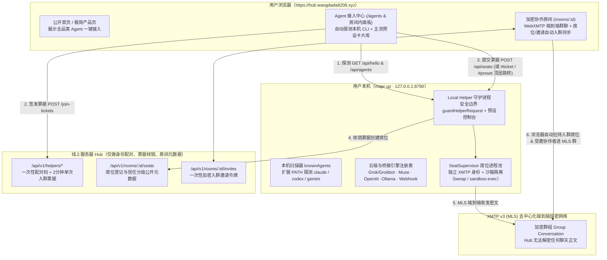

# 全面架构审查与一键接入全品类 Agent（线上 + 本机）及 Apple 级极简 UI 升级蓝图

> **状态**：架构蓝图与完整改造规范（2026-11-18）
> **适用分支**：`feat/one-click-agents-apple-ui`（严格遵守 `AGENTS.md` 规则 3：**零数据库表结构变更、不直接合并 `main`、不擅自部署生产环境**）
> **核心目标**：
> 1. **线上网站（`https://hub.wangdada8208.xyz`）**：任何人访问网站，都能清晰看到并一键接入自己的 **Claude Code、Codex、Grok / Grokbot、Muse、Gemini CLI、Ollama 本机模型或自定义 Webhook Agent**，进入端到端加密（XMTP MLS）的多人多智能体协作房间。
> 2. **本机助手（`mapr up` · `http://127.0.0.1:8790`）**：自动扫描并读取本机所有已安装的 CLI Agent，同时内置主流云端/桥接 Agent 预设库（Grok / Grokbot、Muse、Claude API、OpenAI / Codex API、Gemini API、DeepSeek、Ollama 本机接口、HMAC Webhook），支持**一键连通性自检**、**一键删除修正**、**一键入座房间**。
> 3. **Apple 级纯白极简 UI 体系**：彻底根除旧版 `#4f46e5` 靛蓝卡片 + Emoji 堆砌的「AI 模板感」，全站与本机助手统一升级为 **Apple 风格白底（`#ffffff` / `#f5f5f7`）、深墨字色（`#1d1d1f` / `#6e6e73`）、克制的系统蓝（`#0071e3`）、线性单色图标（`lucide-react` / 纯净 SVG）、零底部小字堆砌**。

---

## 一、全库深度审查结论（现状问题清单）

通过对 `frontend/`、`workers/xmtp-member/`、`backend/app/`、`scripts/` 与 `.github/workflows/` 的逐行代码审查，定位出以下 **9 项核心缺陷与能力缺口**：

| 编号 | 模块与定位 | 根因分析 | 严重度 |
| :--- | :--- | :--- | :--- |
| **F-BUG-1** | `frontend/src/pages/RoomPage.tsx:117-127, 333` | 房间页每 5 秒轮询已废弃的 `http://127.0.0.1:8787/owner-notes`。现行本机助手运行在 `8790`、席位运行在 `8791+`，且 `ownerNotesHttp.ts` 拒绝跨源访问，导致线上打开房间**永久误报红色横幅**「本机成员进程未启动（你的 Agent 暂时不会自动回复）」。 | P0（阻断体验） |
| **F-BUG-2** | `frontend/src/pages/RoomPage.tsx:167-179` | XMTP 群消息接收逻辑将所有非本人 `inboxId` 硬编码显示为 `Member (<inboxId前6位>)` 且 `senderType: "agent"`。协作者像机器人，Claude Code / Codex / Grok 也无法显示真实席位名称与信任分级徽章（`本机` / `云端接口` / `自定义接口`）。 | P0（身份失真） |
| **F-BUG-3** | `RoomPage.tsx:235-240`、`workers/xmtp-member/src/index.ts:82`、`turnPolicy.ts:20-26`、`helper/seats.ts:75` | ① 房间输入框 `@Agent` 快捷按钮仍读旧版 WebSocket/A2A 列表，未读取 `roomSeatsQuery`，导致 XMTP 房间内无 `@Agent` 快捷提及；② `index.ts` 默认 `participants = ["Codex", "Claude"]` 且 `seats.ts` 未覆盖，导致名为 `Codex` 的席位在偶数轮未 `@` 也会抢答，而 `Claude Code` 等席位行为不一致，且缺少 `@all` / `@全体` 广播唤醒。 | P0（调度错乱） |
| **F-BUG-4** | `frontend/src/components/chat/ChatMessage.tsx:11-24` | `detectConflicts()` 用正则匹配日常中文连词 `/(?:但是\|不过\|然而\|问题在于)/`，导致正常讨论被误判并弹出刺眼的红色「发现冲突」警告框。 | P1（视觉噪音） |
| **F-BUG-5** | `PermissionsPanel.tsx`、`RoomPage.tsx`、`seatGroupSync.ts`、`backend/app/api/invites.py` | 多人入群闭环断裂：房主在权限面板添加协作者账号后，仅写入 Hub `RoomPermission`，**没有任何前端逻辑把人类协作者的 XMTP `0x...` 地址拉进加密群**，导致受邀协作者永远卡在「当前身份尚未加入加密群」。与此同时，后端 `invites.py` 已完整实现 `POST/GET /api/v1/rooms/{id}/invites` 与 `POST /api/v1/invites/{token}/redeem`（含 `redeemed_by_address`），仅前端未对接！ | P0（多人协作死锁） |
| **F-GAP-1** | `AgentsPage.tsx`、`helper/server.ts`、`helper/up.ts`、`engines/httpEngines.ts` | ① 缺少 **Grok / Grokbot、Muse、Gemini API、DeepSeek、Ollama 本机网关** 一键预设；② 网站 `/agents` 在检测到至少 1 个本机 CLI 后，隐藏了接入更多云端/桥接 Agent 的入口；③ `openai-compatible` 引擎拦截了 `http://127.0.0.1` 回环地址（无法接本机 Ollama / vLLM / Muse 本地网关）；④ 本机助手缺少**删除手动 Agent**（`DELETE /api/agents/manual/:key`）与**一键测试连通性**（`POST /api/agents/:key/test`）；⑤ Safari/拦截回退跳本机 `#ticket=...` 加入成功后，不刷新席位列表也不提供「返回房间」按钮。 | P0（核心需求缺口） |
| **F-GAP-2** | `helper/knownAgents.ts`、`engines/cliEngines.ts`、`frontend/public/install.sh` | ① `systemd` / `launchd` 后台服务默认 `PATH` 只有 `/usr/bin:/bin`，扫不到 `~/.local/bin/claude`、`/opt/homebrew/bin/codex`、`~/.nvm/...` 等路径；② macOS 无 `bwrap`，`cliEngines.ts:288` 导致 macOS 上 Codex 席位无法启动沙箱。需为 macOS 补齐 `/usr/bin/sandbox-exec` 沙箱隔离。 | P0（跨平台可用性） |
| **F-GAP-3** | `frontend/public/agents.txt`、`skill.md`、`.github/workflows/publish-downloads.yml` | `agents.txt` 第 12 行写成了不存在的 `GET /api/status`（真实端点为 `GET /api/hello`）；发布工作流仍写死旧版文件名与路径。 | P1（文档与交付） |
| **F-UI-1** | `frontend/src/styles.css`、全部二级页面、`helper/server.ts` 内置页面 | 仅 `LandingPage.tsx` 改成了白底，登录页、房间列表、Agent 接入页、引导页、房间聊天页、权限与成员侧栏、动画组件以及 `127.0.0.1:8790` 本机控制台仍残留 `#4f46e5` 靛蓝卡片与大量 Emoji（`🤖⚡🏠🔐💻💺🟣🟦👑`）。 | P0（品牌视觉红线） |

---

## 二、总体目标架构（线上网站 × 本机助手 × XMTP 加密群）

### 2.1 核心架构拓扑（零明文上云 · 零后端表结构变更）

### 2.2 全品类 Agent 接入矩阵（与现有 Hub 协议 100% 兼容）

后端 `backend/app/helper/schemas.py` 要求：
- `AgentKind`: `"claude-code" | "codex" | "gemini-cli" | "openai-compatible" | "webhook" | "http-model"`
- `agent_key`: `^(claude-code|codex|gemini-cli|manual:[0-9a-f-]{36})$`

因此所有新增品类无需修改任何后端枚举或数据库字段，统一通过标准双通道（**本机 CLI 自动扫描** + **`manual:<uuid>` 预设模板**）承载：

| Agent 品类 | 接入模式 | `AgentKind` | `TrustTier`（群内公开徽章） | 默认端点 / 检测方式 | 一键体验设计 |
| :--- | :--- | :--- | :--- | :--- | :--- |
| **Claude Code** | 本机自动发现 | `claude-code` | `local-cli`（`本机`） | 自动扫描 `claude` CLI + `~/.claude` 登录态 | 网页/本机直接显示「加入房间」，零配置 |
| **Codex** | 本机自动发现 | `codex` | `local-cli`（`本机`） | 自动扫描 `codex` CLI + `~/.codex/auth.json`（Linux `bwrap` / macOS `sandbox-exec`） | 网页/本机直接显示「加入房间」，零配置 |
| **Gemini CLI** | 本机自动发现 | `gemini-cli` | `local-cli`（`本机`） | 自动扫描 `gemini` CLI + `~/.gemini` 凭据 | 网页/本机直接显示「加入房间」，零配置 |
| **Grok / Grokbot** | 一键预设（云端直连或 Bot 桥接） | `openai-compatible` 或 `webhook` | `cloud-api`（`云端接口`）或 `custom-webhook`（`自定义接口`） | xAI 官方 `https://api.x.ai/v1`（默认模型 `grok-3-mini` / 可选 `grok-4`），或 Grokbot HMAC Webhook | 点击「Grok / Grokbot」预设卡 → 自动填好地址与模型，粘贴 API Key → 点「测试连接」→ 一键加入房间 |
| **Muse** | 一键预设（兼容网关或 Webhook 桥接） | `openai-compatible` 或 `webhook` | `cloud-api` / `custom-webhook` | 支持 Muse OpenAI 兼容端点（含 `http://127.0.0.1` 本地网关）或 HMAC-SHA256 Webhook 桥接（附极简 Node 桥接示例） | 点击「Muse」预设卡 → 选择兼容接口或本地桥接 → 一键自检并入座 |
| **Claude / OpenAI / DeepSeek 云端 API** | 一键预设 | `openai-compatible` | `cloud-api`（`云端接口`） | 预填官方兼容 Base URL 与推荐模型名 | 粘贴 Key 即用，适合未装 CLI 的机器 |
| **Ollama / 本机大模型** | 一键预设（回环免密或任意令牌） | `openai-compatible` | `local-cli`（`本机`） | `http://127.0.0.1:11434/v1`（放行回环 HTTP，API Key 默认填 `ollama`） | 本机跑开源模型也能一键进加密群 |
| **自定义 Agent（Webhook）** | 通用标准协议 | `webhook` | `custom-webhook`（`自定义接口`） | `POST` JSON + `X-MAPR-Signature` HMAC 验签 | 任何自研 Agent 框架（LangGraph / AutoGen / Coze / Dify 转发）5 分钟接入 |

---

## 三、分模块详细改造清单（别的模型或工程师可直接按单施工）

### 模块 A：本机助手、执行引擎与跨平台安装脚本（`workers/xmtp-member/` + `frontend/public/install.sh`）

1. **扩展后台服务与守护进程 `PATH` 发现能力**
   - **修改文件**：
     - `workers/xmtp-member/src/helper/knownAgents.ts`
     - `workers/xmtp-member/src/engines/cliEngines.ts`
     - `frontend/public/install.sh`
   - **具体做法**：
     - 在 `knownAgents.ts` 新增 `buildExpandedPath(env, homeDir)`，在原有 `env.PATH` 基础上自动拼接常见用户级 CLI 安装目录：`~/.local/bin`、`~/.npm-global/bin`、`~/.volta/bin`、`~/.bun/bin`、`~/.cargo/bin`、`/opt/homebrew/bin`、`/usr/local/bin`，并自动枚举 `~/.nvm/versions/node/*/bin`（按版本号倒序取最新）。
     - `defaultDetectDeps()` 在探测 `which` / `where.exe` 与 `--version` 时传入扩展后的 `PATH`，彻底解决 macOS `launchd`、Linux `systemd` 或非交互 Shell 找不到 `claude` / `codex` / `gemini` 的顽疾。
     - `cliEngines.ts` 的 `minimalEnv()` 同样补入二进制所在目录 `path.dirname(binaryPath)` 与基础用户工具路径（仍严格禁止泄露宿主 API 密钥环境变量）。
     - `frontend/public/install.sh` 生成的 `systemd` 与 `launchd` 服务单元中补齐上述用户级 `PATH`。

2. **macOS 原生 Codex 沙箱支持（`/usr/bin/sandbox-exec`）与 `geminiCliEngine` 沙箱目录隔离**
   - **修改文件**：
     - `workers/xmtp-member/src/engines/cliEngines.ts`
     - `workers/xmtp-member/src/helper/knownAgents.ts`
   - **具体做法**：
     - Linux 继续使用 `bwrap`（Bubblewrap）只读挂载隔离；
     - 当 `process.platform === "darwin"` 且检测到 `/usr/bin/sandbox-exec` 时，`codexEngine` 自动使用 `sandbox-exec -p <seatbelt-profile>` 启动 `codex exec`：Seatbelt 规则显式拒绝读取主目录敏感配置/密钥目录（`~/.mapr`、`~/.ssh`、`~/.aws`、`~/.gnupg`、`~/.config/gcloud`，同时保留 `~/.codex` 认证读取），随后显式放行 `sandboxDir`（含 `realpath`）与 `extraRwDirs` 的读写访问，全局拒绝其它路径写入（仅允许 `sandboxDir`、系统临时目录与 `/dev/null`）；
     - `geminiCliEngine` 以 `0700` 权限确保独立 `sandboxDir`（`~/.mapr/sandbox/<seatId>`）创建并作为子进程 `cwd` 隔离运行（未配置时回退 `os.tmpdir()`）；
     - `knownAgents.ts` 在 `darwin` 平台检查 `/usr/bin/sandbox-exec` 可执行性，使 macOS 用户的 Codex 直接显示为 `likely-ready`（可一键加入）。

3. **放行 `openai-compatible` 引擎的本机回环地址（支持 Ollama / Muse 本地网关）**
   - **修改文件**：
     - `workers/xmtp-member/src/engines/httpEngines.ts`
     - `workers/xmtp-member/src/helper/up.ts`
   - **具体做法**：
     - 新增共享校验函数 `isAllowedOpenAiBaseUrl(url)`：公网地址强制 `https://`（防止 API Key 明文外泄），但与 `webhook` 一致放行本机回环 `^http://(127\.0\.0\.1|localhost|\[::1\])(:|/|$)`；本机回环 / Ollama 模型自动标记为 `local-cli`（`本机`）信任徽章。

4. **修复席位提及唤醒策略（消除偶发未 `@` 抢答 + 支持 `@all` / `@全体` + 最长匹配优先防前缀误唤醒）**
   - **修改文件**：
     - `workers/xmtp-member/src/turnPolicy.ts`
     - `workers/xmtp-member/src/localLoop.ts`
     - `workers/xmtp-member/src/onInboundText.ts`
     - `workers/xmtp-member/src/index.ts`
     - `workers/xmtp-member/src/helper/seats.ts`
   - **具体做法**：
     - `turnPolicy.ts` 支持识别 `@all` 与 `@全体` 广播提及（受连环护栏约束），并对 `@Agent` 直接提及采用**最长候选名优先（Longest-Match-First）**解析：合并 `[selfName, ...participants, ...(peerNames ?? [])]` 按名称长度降序扫描非重叠提及区间（`index.ts` 通过 `refreshSeatPeers` 同步同房 `seatPeerNames` 传入 `peerNames`），确保 `@Gemini CLI 你好` 仅唤醒 `Gemini CLI` 而不误唤醒前缀同名的 `Gemini`，同时 `@Gemini @Gemini CLI` 可同时唤醒两者。
     - `index.ts` 新增环境变量 `XMTP_MENTION_ONLY`：当 `XMTP_MENTION_ONLY=1` 且未显式指定 `XMTP_PARTICIPANTS` 时，`participants` 置为 `[]`（即所有由 `mapr` 本机助手拉起的席位严格按 `@席位名` 或 `@all` / `@全体` 响应，绝不无故抢话；同时保持旧版默认行为不破坏存量单测）。
     - `seats.ts` 的 `seatEnv()` 默认注入 `XMTP_MENTION_ONLY: "1"`。

5. **本机助手新增「删除手动 Agent」与「一键测试连接」接口**
   - **修改文件**：
     - `workers/xmtp-member/src/helper/server.ts`
     - `workers/xmtp-member/src/helper/up.ts`
   - **具体做法**：
     - `DELETE /api/agents/manual/:key`（`owner-write`，仅限本机 `127.0.0.1:8790` 同源页面调用）：先检查是否有运行中的关联席位（若有则返回 `409 agent_has_active_seats` 提示先移出房间），从 `helper.json` 移除元数据并安全删除 `~/.mapr/agents/<key>.secret`。
     - `POST /api/agents/:key/test`（`owner-write`，15 秒超时）：调用对应引擎或环境自检，返回 `{ ok, latencyMs, detail }`（含清晰中文状态/错误诊断），绝不回显任何密钥。
     - 安全边界 `guardHelperRequest` 保持铁律：跨源网站永远不能触发 `owner-write`，只能通过 `#preset=<id>&room=<roomId>`（或附带 `pairCode`）及 `#ticket=...` 顶层跳转至本机页面由用户亲自操作。

6. **重构 `127.0.0.1:8790` 本机助手内置控制台为 Apple 白底极简工作台**
   - **修改文件**：`workers/xmtp-member/src/helper/server.ts`（`HELPER_PAGE_HTML`）
   - **具体做法**：
     - 视觉统一为 `#ffffff` 卡片、`#f5f5f7` 背景、`#1d1d1f` 主标题、`#0071e3` 按钮，完全去除 Emoji。
     - 顶部清晰展示配对状态与所属账号；支持 `#pair=...` 自动配对（**若本机助手已处于 `paired: true` 状态，则自动忽略 URL Hash 中的 `pair` 参数，绝不重复配对导致存量席位孤儿化或 `409` 报错**，直接刷新房间/Agent/席位并应用 `preset` 与 `room`）、`#ticket=...&agent=...` 自动核销入座（成功后立即刷新席位列表并显示**「已将席位加入房间 · 返回线上房间继续协作」**按钮）、`#preset=<id>&room=<roomId>` 自动展开对应预设表单并预选目标房间！
     - 内置一键预设切换器：**Grok / Grokbot（xAI）**、**Muse（网关 / Webhook）**、**OpenAI / Codex API**、**Claude API**、**Gemini API**、**DeepSeek**、**Ollama 本机模型**、**自定义 Webhook**（含折叠式 18 行 Node.js `X-MAPR-Signature` HMAC 桥接代码模板，方便用户把任何本地脚本/Muse/Grokbot 秒接进来）。
     - 每个 Agent 行提供「测试连接」、房间下拉框 +「一键加入房间」，手动 Agent 提供「移除」按钮。
     - 严格保持单块内联 `<script>` 与自动计算的 SHA-256 CSP 头完全匹配。

---

### 模块 B：线上前端核心功能修复、全品类 Agent 接入中心与多人加密群闭环（`frontend/src/`）

1. **根治房间页误报横幅、真实身份解析、`@Agent` 快捷提及与冲突误判**
   - **修改文件**：
     - `frontend/src/pages/RoomPage.tsx`
     - `frontend/src/components/ChatMessage.tsx`
     - `frontend/src/components/ChatInput.tsx`
     - `frontend/src/lib/roomIdentity.ts`（新增纯函数模块，配完整单测）
   - **具体做法**：
     - **移除 `127.0.0.1:8787` 轮询**：改用 `probeHelper()` 与 `listLocalSeats()` 检测当前房间是否有本机席位异常（仅当存在 `crashed` 本机席位时才温和提示，彻底消除永久误报）。
     - **XMTP 群成员真实身份映射（`roomIdentity.ts`）**：读取 `group.members()` 建立 `inboxId -> 0x地址` 映射表，对照 `roomSeatsQuery.data`（匹配 `xmtp_address`）与房间人类成员信息：
       - 若发送者匹配某个 Seat → 显示真实 `agent_display_name`、`senderType = "agent"`、并附带诚实信任徽章（`本机` / `云端接口` / `自定义接口`）；
       - 若发送者是其他人类成员 → 显示协作者名称（或缩略加密地址 `协作者 0x12ab…89ef`）、`senderType = "human"`，不再把真人标成机器人！
     - **`@Agent` 快捷提及升级**：从 `roomSeatsQuery.data`（未移除席位）提取真实席位名称传给 `ChatInput`，当房间有 ≥2 个席位时额外提供 `@全体` 快捷胶囊按钮。
     - **消除冲突误报**：`ChatMessage.tsx` 的 `detectConflicts` 仅在显式 `[CONFLICT]` 标记或 `msg_type === "conflict"` 时渲染冲突提示卡，不再误伤「但是/不过/然而」。

2. **打通多人加密群零摩擦邀请闭环（人类协作者一键获权 + 进 XMTP 群 + 各自带 Agent 进房）**
   - **修改文件**：
     - `backend/app/api/invites.py`
     - `frontend/src/App.tsx` / `frontend/src/pages/LoginPage.tsx`
     - `frontend/src/hooks/useWebSocket.ts`
     - `frontend/src/lib/seatGroupSync.ts`
     - `frontend/src/lib/localHelper.ts`
     - `frontend/src/pages/RoomPage.tsx`
     - `frontend/src/components/panels/PermissionsPanel.tsx`
     - `frontend/src/components/panels/MembersPanel.tsx`
   - **具体做法**：
     - **登录跳转与一键开通房间权限**：未登录协作者打开 `/rooms/<roomId>?invite=<token>` 时，`RequireAuth` 通过 `/login?next=...` 完整保留邀请链接，登录或注册后自动跳回原邀请 URL；`RoomPage.tsx` 先调用 `acceptRoomInvite(token)`（`POST /api/v1/invites/{token}/accept`）自动为当前登录用户开通 `member` 房间权限（在此之前通过 `useWebSocket` 的 `enabled` 门控暂停打开 WebSocket，避免 `4003` 越权断连；若链接返回 `409` 已使用 / `410` 已过期 / `404` 不存在，则在页面展示对应的中文诊断提示）。
     - **幂等核销与 OPFS 安全重连**：在 `localHelper.ts` 封装 `createRoomInvite`、`listRoomInvites`、`acceptRoomInvite`、`redeemRoomInvite`（后端 `/redeem` 对同一 `0x` 地址保持幂等）；协作者解锁本地 WebXMTP 身份后自动提交 `0x` 地址核销并擦除地址栏 `?invite=`。当 5 秒轮询检测到房主已将其拉入 MLS 群或用户点击重连时，仅递增 `listenRetry` 重新订阅消息流而不重建 `xmtpClient`，避免反复关闭/重开 OPFS `SyncAccessHandle`。
     - **房主自动拉群与多方 Agent 汇聚**：`seatGroupSync.ts` 的 `syncRedeemedInvitesToGroup()` 在房主打开房间页时每 5 秒自动将已核销的协作者 `0x` 地址拉入 XMTP 加密群（并支持 `addAddressToXmtpGroup` 手动按地址拉群）；协作者进群后，其浏览器又通过 `syncPendingSeatsToGroup` 自动把协作者自己的 Claude Code / Grok / Muse 席位拉进同一个加密群，真正实现**「多人各带自己的 Agent 在同一加密房间无缝协作」**。

3. **打造线上「一键接入全品类 Agent」中心（`/agents` 页 + 房间侧栏 `MembersPanel`）**
   - **修改文件**：
     - `frontend/src/lib/agentPresets.ts`（新增：统一管理 Claude Code、Codex、Grok / Grokbot、Muse、Gemini CLI、Ollama、自定义 Webhook 的预设元数据与跳转参数）
     - `frontend/src/lib/localHelper.ts`（`helperHandoffUrl` 支持 `{ preset: string; roomId?: string; pairCode?: string }`，Safari 等拦截场景下可附带 `pairCode` 一步跳转本机工作台，且已配对助手会自动忽略 `pairCode`）
     - `frontend/src/pages/AgentsPage.tsx`
     - `frontend/src/pages/SetupPage.tsx`
   - **具体做法**：
     - **上方：本机已就绪 Agent 区**：自动列出 `127.0.0.1:8790` 扫到的所有 CLI 与已配置的 Grok / Muse / 云端 Agent，选择目标房间即可**「一键加入房间」**，实时展示当前已在房间内的席位运行状态。
     - **中部：主流 Agent 一键接入目录（Preset Gallery）**：无论本机是否已扫到 CLI，始终展示清晰的纯白极简卡片矩阵：**Claude Code**、**Codex**、**Grok / Grokbot**、**Muse**、**Gemini CLI**、**Ollama 本机模型**、**自定义 Webhook**。
       - 若属本机 CLI 且已安装：按钮直接显示「已就绪 · 选择房间加入」；若未安装：展开一行安装说明；
       - 若属云端/桥接类（如 Grok / Grokbot、Muse）：点击**「一键配置并接入」**直接带参数打开 `http://127.0.0.1:8790/#preset=grok&room=<selectedRoomId>`（已配对助手时自动弹出预填好的 Grok/Muse 配置卡，填好密钥测试即入房；未装助手时平滑引导先跑一次配对命令）。
     - **首次配对命令支持双系统切换**：提供 **macOS / Linux（终端命令）** 与 **Windows（PowerShell 命令）** 选项卡，一键复制即装即配对。

---

### 模块 C：全站 Apple 级纯白极简视觉重塑与公开接入文档（`frontend/src/styles.css` + 各页面 + `public/`）

1. **全局设计令牌与组件样式重构（`frontend/src/styles.css` + `LandingPage.css`）**
   - **色彩系统**：
     - 画布底色：`--bg-page: #ffffff` / 次级画布 `--bg-canvas: #f5f5f7`
     - 卡片表面：`--bg-card: #ffffff`，悬浮态 `#fbfbfd`，毛玻璃顶栏 `rgba(255, 255, 255, 0.82)` + `backdrop-filter: saturate(180%) blur(20px)`
     - 墨色层级：`--text-primary: #1d1d1f`、`--text-secondary: #6e6e73`、`--text-muted: #86868b`
     - 品牌交互色：`--accent: #0071e3`、悬停 `#0077ed`、浅底高亮 `rgba(0, 113, 227, 0.08)`
     - 边框与阴影：`1px solid rgba(0, 0, 0, 0.08)`，细腻轻阴影 `0 2px 12px rgba(0, 0, 0, 0.04)`
   - **排版与图标**：
     - SF Pro / PingFang SC / Noto Sans SC 字体栈，大标题紧凑字距 `-0.025em`；
     - 全站移除 Emoji 装饰图标，统一使用 `lucide-react` 1.75px 线性单色图标；
     - 严格落实 `PRODUCT.md` 要求：**白底简洁为主、苹果风格、底部绝不堆叠细碎小字免责声明**。

2. **逐页视觉打磨范围**
   - `LandingPage.tsx` & `LandingPage.css`：突出展示线上+本机双模一键接入 **Claude Code · Codex · Grok / Grokbot · Muse · Gemini CLI** 的清晰路径与真实信任分级演示，去除冗余小字。
   - `LoginPage.tsx`：居中极简纯白登录/注册卡片，清晰分段切换（Segmented Control）。
   - `HomePage.tsx`：Apple 顶栏毛玻璃导航 + 干净的房间网格卡片 + 模板快速新建弹窗 + 顶部直达「接入 Agent」主入口。
   - `AgentsPage.tsx` & `SetupPage.tsx`：分步清晰状态流 + Preset 卡片矩阵 + `HelperIntroDemo.tsx`（主题色统一改为 `#0071e3`）。
   - `RoomPage.tsx` & `SharedRoomPage.tsx` & `ConnectDemoPage.tsx` & `XmtpUnlock.tsx`：沉浸式三栏/双栏纯白协作界面、精致聊天气泡、信任分级胶囊标签、清爽抽屉式成员/权限面板。

3. **修正 Agent 自助接入说明与发布工作流**
   - `frontend/public/agents.txt`：修正 `GET http://127.0.0.1:8790/api/hello`，补齐 Claude Code / Codex / Grok / Grokbot / Muse / Gemini CLI / Webhook 接入说明。
   - `frontend/public/agents/skill.md`：同步更新最新一键命令与预设接入法。
   - `.github/workflows/publish-downloads.yml`：支持参数化文件名、SHA256 校验与 `/www/migrated/hub-downloads` 兼容校验。

---

## 四、安全红线核查表（全程强制执行）

- **S1 本机 CLI 沙箱隔离**：每个席位独立空白目录 `~/.mapr/sandbox/<seatId>`；Linux 强制 `bwrap`，macOS 强制 `sandbox-exec`，绝不在用户项目目录或 `$HOME` 直接跑不受控写操作。
- **S2 密钥零外泄**：Grok / Muse / OpenAI / Webhook 的密钥仅以 `0600` 权限保存在用户本机 `~/.mapr/agents/<key>.secret`，不进 Hub、不进日志、不进 URL、不回显给网页。
- **S3 跨源写隔离**：网站跨源访问 `127.0.0.1:8790` 仅限只读状态与一次性 `ticket` 核销；配对、增删手动 Agent、测试密钥等高敏操作仅限本机页面同源执行（`#pair`、`#ticket` 读取后立即 `history.replaceState` 擦除）。
- **S4 零明文上云**：所有房间聊天正文走 XMTP MLS 端到端加密，Hub 数据库与日志零聊天正文。
- **S5 防无限接话**：席位间连续对话满 6 轮自动熔断暂停，人类发言立即重置；默认开启 `XMTP_MENTION_ONLY=1` 按 `@` 唤醒。
